# Do Machine Learning and Neural Networks Beat Classical Models at Predicting Next-Day Stock Direction?

**A Walk-Forward Comparison on Eight U.S. Equities, 2020-2024**

<b>Mubarak Odufade</b> 
Department of Computer Science, College of Staten Island, City University of New York 
Faculty Mentor: Dr. Yumei Huo 
November 2026

---

## Abstract

Whether machine-learning and deep-learning models can predict short-term stock movements better than simple
statistical models is a central and contested question in quantitative finance. We study it under conditions designed to
avoid the usual sources of false optimism. Two classical models (logistic regression and ARIMA), two machine-learning
models (random forest and XGBoost) and one neural network (an LSTM) forecast the next-day direction of 8
liquid U.S. equities, and are compared with an always-"up" benchmark. Every model is retrained each year on a rolling
5-year window and judged only on the following unseen year (2020-2024;
10,048 out-of-sample predictions). Predictions are then traded in a long/cash backtest with transaction costs. All
models reach 50.7%-51.6% accuracy with ROC-AUC between
0.494 and 0.505, below the 52.5% of always predicting "up". After Holm
correction, none of the 6 accuracy comparisons between a challenger and a classical baseline is statistically
significant (0 of 6). The LSTM has the best backtest Sharpe ratio (1.78 versus
1.31 for logistic regression), but that advantage is significant only against ARIMA
(1 of 6 Sharpe comparisons), and it rests on low turnover rather than on better predictions. We fail to
reject the null hypothesis that added model complexity gives no significant improvement.

**Keywords:** stock direction prediction, walk-forward validation, LSTM, XGBoost, random forest, ARIMA, backtesting,
Diebold-Mariano test, market efficiency

---

## 1. Introduction

Each trading day, a model that could tell in advance whether a stock will close higher or lower tomorrow would be
valuable. The efficient-market hypothesis (Fama, 1970) argues that, in its weak form, past prices contain no such
information. Empirical work has found that return predictability is weak and unstable (Welch & Goyal, 2008), yet recent
studies report that machine-learning methods can extract signal that linear models miss (Gu, Kelly & Xiu, 2020; Fischer &
Krauss, 2018). At the same time, financial machine learning is prone to over-optimistic results, caused by look-ahead
leakage, repeated tuning on test data and backtest overfitting (Bailey, Borwein, López de Prado & Zhu, 2014; López de
Prado, 2018).

This project asks a narrow, testable version of the question:

> Do machine-learning and deep-learning models significantly outperform classical models at predicting next-day return
> direction, under strict walk-forward validation and realistic trading costs?

- **H0:** there is no significant difference in predictive performance between classical and ML/deep-learning models.
- **H1:** ML and/or deep-learning models significantly outperform the classical baseline.

**Contributions.** (i) A leakage-controlled walk-forward comparison of six strategies on one common set of predictions;
(ii) formal significance testing of both accuracy and risk-adjusted return, with a multiple-comparison correction;
(iii) analysis of *why* any backtest advantage appears, covering market exposure, turnover and sensitivity to trading
costs; and (iv) a fully reproducible pipeline and interactive website that regenerate every number in this paper.

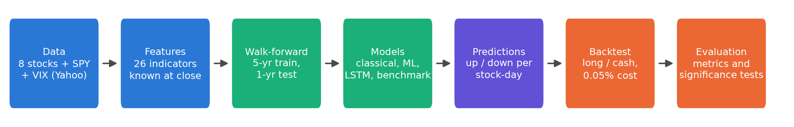
*Figure 1. The study pipeline, from raw prices to significance tests.*

---

## 2. Background and related work

**Market efficiency and predictability.** Under weak-form efficiency, prices already reflect all past price
information, so technical indicators should not predict returns (Fama, 1970). Welch and Goyal (2008) showed that many
variables proposed to predict returns fail out of sample. This sets a high bar and motivates our emphasis on
out-of-sample testing.

**Machine learning for returns.** Gu, Kelly and Xiu (2020) found that tree-based models and neural networks improve
return forecasts for cross-sections of stocks using a large panel of characteristics. Fischer and Krauss (2018) reported
profitable LSTM signals for S&P 500 constituents before costs and in an earlier period. Our setting is narrower (eight
stocks, price-based indicators, one-day horizon, recent data) and deliberately conservative.

**Methodological cautions.** Backtests that are tuned repeatedly overfit (Bailey et al., 2014), and
standard cross-validation leaks information in time series (López de Prado, 2018). We therefore use chronological
splits with a purge, fix every hyperparameter in advance, and test differences formally rather than by ranking.

**Models.** ARIMA (Box & Jenkins, 1970) and logistic regression are the classical baselines. Random forests (Breiman,
2001) and gradient-boosted trees (Chen & Guestrin, 2016) are the machine-learning models. The LSTM (Hochreiter &
Schmidhuber, 1997) is the deep-learning model, trained with Adam (Kingma & Ba, 2015) and dropout (Srivastava et al.,
2014).

---

## 3. Data

Daily split- and dividend-adjusted Open, High, Low, Close and Volume were downloaded from Yahoo Finance for
AAPL, MSFT, NVDA, JPM, TSLA, XOM, JNJ, WMT (a deliberately mixed set of technology, financial, energy, healthcare and retail firms), plus
SPY (an S&P 500 fund, used as the market) and the VIX index (used as a volatility measure). The
download range is 2014-01-01 to 2024-12-31; 2014 only warms up indicators that need up to 50 days of history,
so the modelled data begin in 2015 (20,112 stock-day observations). Prices are stored in a local SQLite database.

**Target.** For stock *i* on day *t*, `y = 1` if the close on day *t+1* exceeds the close on day *t*, and `0` otherwise.
Up-days make up 52.5% of observations overall (between 50.4% and 54.6% depending
on the stock), so a model that always predicts "up" is right about 53% of the time. Beating that is the real
test, not beating 50%.

---

## 4. Methodology

### 4.1 Features: 26 indicators known at the close

Each feature on day *t* uses only information available at the close of day *t*. A unit test verifies this by
perturbing future prices and checking that no earlier feature changes.

| Family | Features | Definition |
|---|---|---|
| Technical | rsi14 | Relative Strength Index, 14 days (Wilder's smoothing) |
| Technical | macd, macd_signal, macd_hist | 12/26-day EMA difference, its 9-day EMA, and their gap; each divided by price |
| Technical | bb_pctb, bb_width | Position within, and width of, the 20-day Bollinger band (2 standard deviations) |
| Technical | ma5_ratio, ma20_ratio, ma50_ratio | Close divided by its 5/20/50-day mean, minus 1 |
| Technical | atr14_pct | 14-day Average True Range as a fraction of the close |
| Statistical | vol5, vol10, vol20 | Rolling standard deviation of daily returns |
| Statistical | ret_lag1 ... ret_lag5 | The last five daily returns (lag 1 is the day's own return, known at the close) |
| Statistical | skew20, mom5, mom10, mom20 | 20-day return skewness; 5/10/20-day price momentum |
| Market context | mkt_ret, corr_mkt20 | SPY daily return; 20-day rolling correlation of the stock with SPY |
| Market context | vix, vix_chg | VIX level and its one-day change |

Features are standardised (z-scores) using the training window only, inside each model's pipeline, so no test-period
statistics leak into training.

### 4.2 Walk-forward validation

Time series cannot be shuffled: a model must never learn from the future of the period it is tested on. We use a
rolling walk-forward scheme. For each test year *Y* from 2020 to 2024, a new model
is fitted for each stock on the preceding 5 calendar years, then predicts every day of *Y* one day at a
time. The window then rolls forward one year. The last training row of each fold is dropped (purged) because its label
uses the first test-year close. No state is shared across folds or stocks.

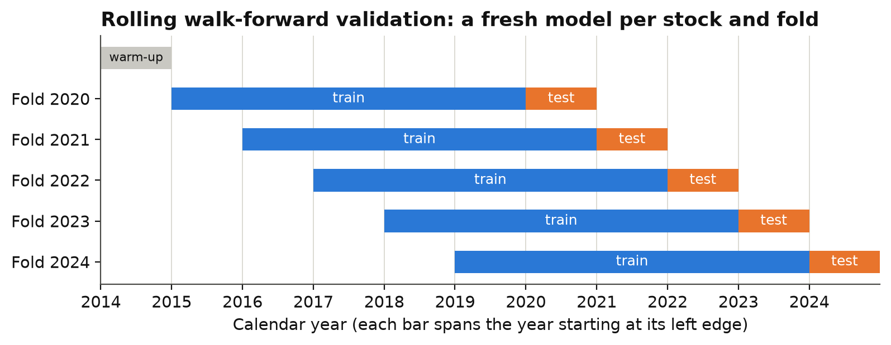
*Figure 2. Rolling walk-forward folds. Each stock and fold gets a freshly trained model.*

### 4.3 Models

Every model outputs a score for "up tomorrow" and a 0/1 prediction. Hyperparameters were fixed in advance, set
conservatively for noisy data, and **not tuned on any test year**.

| Class | Model | Specification |
|---|---|---|
| Benchmark | Buy & hold (always-up) | Predicts up every day; equivalent to staying invested |
| Classical | Logistic regression | L2 penalty (C = 0.1) on standardised features; up if P(up) >= 0.5 |
| Classical | ARIMA(p,0,q) | Order chosen by AIC (p, q <= 2) on the training window; one-step-ahead return forecast; up if forecast > 0; uses only the stock's own returns |
| Machine learning | Random forest | 300 trees, maximum depth 5, minimum 20 samples per leaf, sqrt(features) per split |
| Machine learning | XGBoost | 200 trees, depth 3, learning rate 0.03, 80% row and column subsampling, L2 penalty 5, minimum child weight 10 |
| Deep learning | LSTM | 20-day input window, 32 hidden units, dropout 0.3, Adam (lr 0.001), early stopping on a chronological 15% validation tail |

**The LSTM in plain terms.** Unlike the other models, which see one day's 26 indicators, the LSTM reads the last
20 days in order. It keeps a small memory vector (32 numbers) and, for each new day, uses three learned gates to decide
what to forget, what to store and what to output. After the 20th day, the memory feeds one output neuron whose sigmoid
gives the probability of "up". Training minimises binary cross-entropy; early stopping on a chronological validation
tail (never shuffled into the future) and dropout limit memorisation of noise.

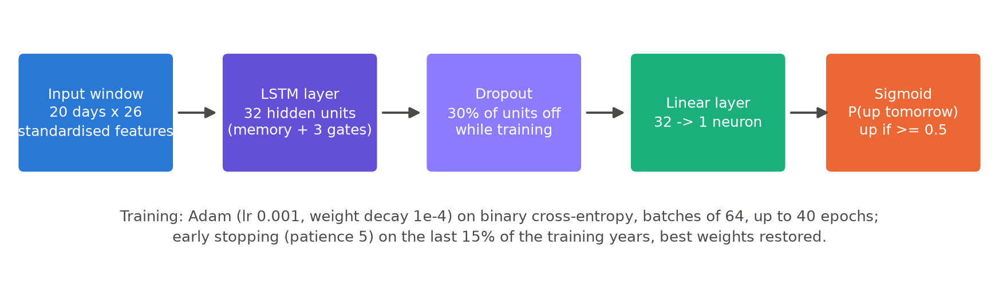
*Figure 3. LSTM architecture and training procedure.*

### 4.4 Backtest

The backtest converts predictions into returns using deliberately simple rules. At each close, if the model predicts
"up" the strategy holds the stock through the next day, otherwise it holds cash (0% return). There is no leverage and
no short selling. Each unit of position change (entering or exiting) costs 0.05%
(5 basis points). The portfolio is an equal-weight, daily-rebalanced average across the 8 stocks.
Reported measures are cumulative and annualised return, the Sharpe ratio (mean over standard deviation of daily
returns, times the square root of 252; zero risk-free rate; Sharpe, 1966), maximum
drawdown, and the Calmar ratio (annualised return over absolute maximum drawdown).

### 4.5 Evaluation metrics and statistical tests

**Classification:** accuracy, precision, recall, F1 and ROC-AUC on the pooled out-of-sample predictions. AUC measures
ranking skill independent of the threshold (0.5 means no skill).

**Significance.** Each challenger (random forest, XGBoost, LSTM) is compared with each classical baseline (logistic
regression, ARIMA), giving 6 one-sided comparisons (H1: challenger better). Accuracy: Diebold-Mariano test
(Diebold & Mariano, 1995) on daily 0/1 loss averaged across stocks, with a Newey-West (1987) long-run variance and the
Harvey-Leybourne-Newbold (1997) small-sample correction; a paired t-test on per-stock, per-year accuracies; and a
stationary block bootstrap (Politis & Romano, 1994; 5,000 draws, mean block 10 days)
for confidence intervals. Sharpe differences use the same bootstrap on paired daily returns. P-values are adjusted
across the 6 comparisons with Holm's (1979) step-down method; a result counts as significant at
5% only if its Holm-adjusted p-value is below 0.05.

---

## 5. Assumptions

The conclusions hold under the following explicit assumptions. Several are simplifications that a real trading
operation would not share.

1. **Information timing.** Features are computed from the close of day *t*, and a trade at that close earns the *t* to
   *t+1* return. This assumes execution at the closing price, which is optimistic for large orders.
2. **Transaction costs.** A single proportional cost of 0.05% per unit of turnover,
   with no market impact, bid-ask spread dynamics, slippage or taxes. Section 7.3 varies this assumption.
3. **Zero risk-free rate** in the Sharpe ratio, and cash earns 0% when out of the market.
4. **Long/cash only,** with no leverage or short selling, so a "down" call can only avoid a loss, not profit.
5. **Equal weighting and daily rebalancing** across the 8 stocks.
6. **Stationarity within a window.** Relationships learned over 5 years are assumed to persist for the
   next year. Retraining each year is the only adaptation.
7. **Fixed hyperparameters.** No search was run; the settings are conservative defaults chosen before looking at test
   results, and each stochastic model uses a single random seed (42).
8. **Data quality.** Yahoo Finance adjusted prices are treated as correct, although they are revised retroactively
   (Section 9).
9. **Test-statistic assumptions.** The Diebold-Mariano test and block bootstrap assume the daily loss differences are
   weakly dependent and stationary. Averaging across stocks per day reduces, but does not remove, cross-sectional
   dependence. The accuracy error bars in Figure 4 assume independent predictions and are therefore too narrow.
10. **Universe.** The eight stocks are large, liquid and survived to 2024, so the study is subject to survivorship and
    selection bias that favours long positions.

---

## 6. Results

### 6.1 Predictive performance

Table 1 and Figure 4 summarise the 10,048 pooled out-of-sample predictions.

| Model | Accuracy | Precision | Recall | F1 | ROC-AUC |
|---|---:|---:|---:|---:|---:|
| Buy & hold | 0.5253 | 0.5253 | 1.0000 | 0.6888 | 0.5000 |
| Logistic | 0.5125 | 0.5288 | 0.6612 | 0.5876 | 0.5046 |
| ARIMA | 0.5068 | 0.5233 | 0.6845 | 0.5932 | 0.4945 |
| Random forest | 0.5140 | 0.5276 | 0.7156 | 0.6074 | 0.5039 |
| XGBoost | 0.5122 | 0.5301 | 0.6290 | 0.5753 | 0.5042 |
| LSTM | 0.5165 | 0.5265 | 0.7893 | 0.6317 | 0.5020 |

*Table 1. Pooled out-of-sample classification metrics, 2020-2024.*

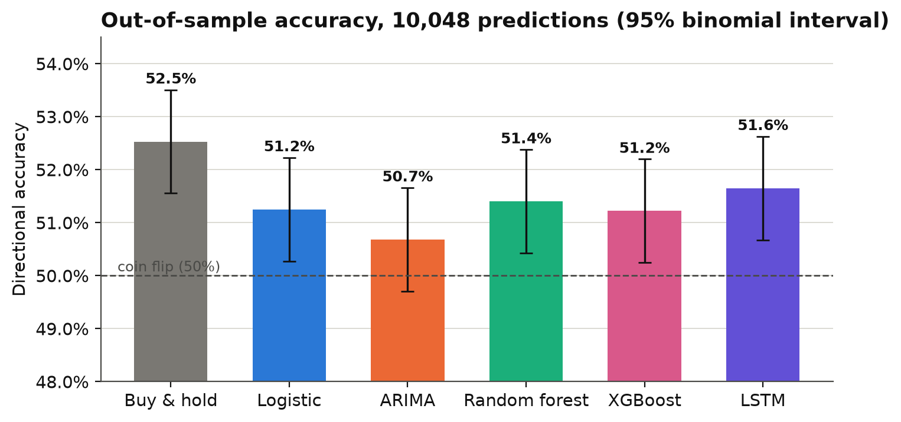
*Figure 4. Directional accuracy with 95% binomial intervals (which assume independent predictions and so understate
the real uncertainty).*

No model beats the always-up benchmark on accuracy. All ROC-AUC values lie between 0.494 and 0.505, so
there is essentially no ranking signal (Figure 5). Accuracy and F1 differ across models mainly because models differ in
how often they say "up" (recall), not because they separate up-days from down-days better.

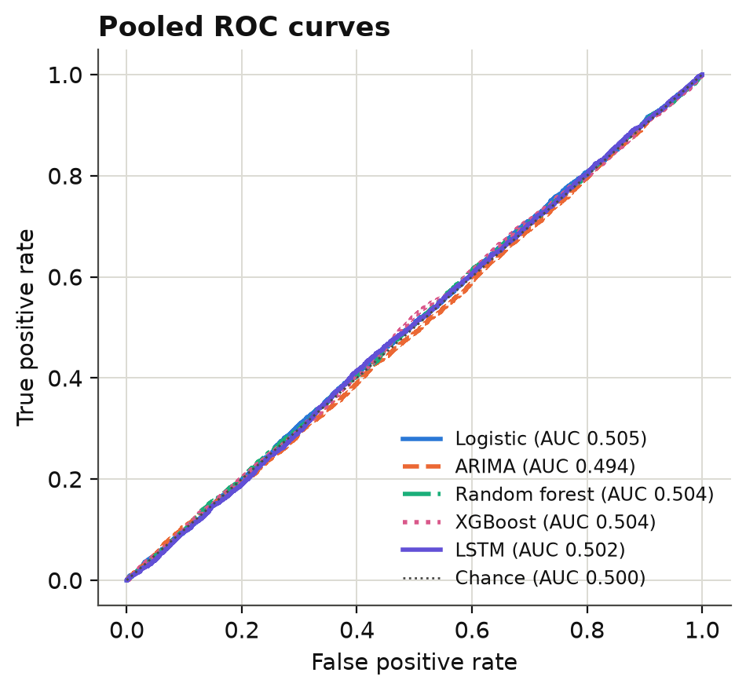
*Figure 5. Pooled ROC curves. All models track the diagonal (no skill).*

### 6.2 Backtest

| Strategy | Cumulative return | Annualised | Sharpe | Max drawdown | Calmar |
|---|---:|---:|---:|---:|---:|
| Buy & hold | 365% | 36.1% | 1.38 | -33.3% | 1.09 |
| Logistic | 223% | 26.6% | 1.31 | -20.7% | 1.28 |
| ARIMA | 147% | 19.9% | 1.07 | -21.4% | 0.93 |
| Random forest | 219% | 26.2% | 1.22 | -29.2% | 0.90 |
| XGBoost | 197% | 24.4% | 1.24 | -23.4% | 1.04 |
| LSTM | 305% | 32.4% | 1.78 | -19.6% | 1.65 |

*Table 2. Equal-weight portfolio backtest, 0.05% cost per unit of turnover.*

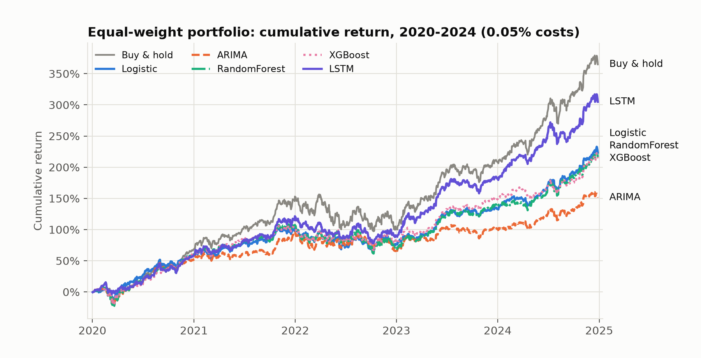
*Figure 6. Cumulative return of each strategy.*

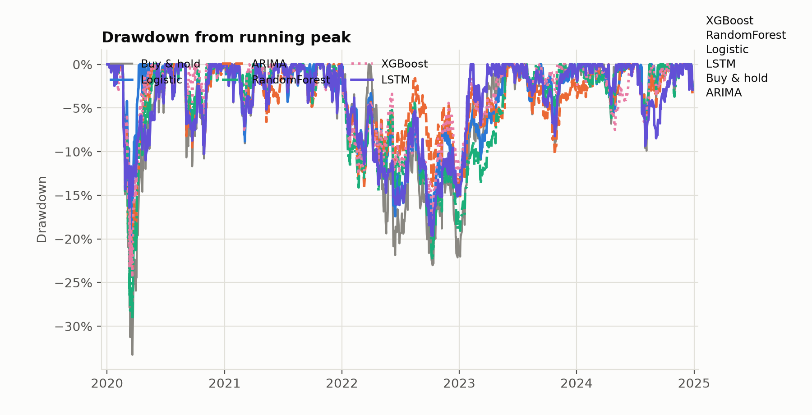
*Figure 7. Drawdown from the running peak.*

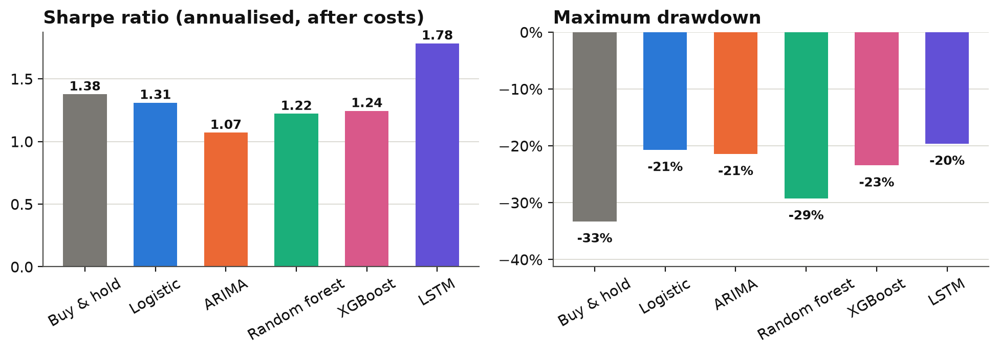
*Figure 8. Sharpe ratio and maximum drawdown by strategy.*

Buy-and-hold earns the highest cumulative return (365%), reflecting the strong 2020-2024 market for these
stocks. The LSTM comes closest (305%) and has the highest Sharpe (1.78) and Calmar
(1.65) ratios and the smallest drawdown (-19.6%). The classical and
tree-based strategies earn less than buy-and-hold.

### 6.3 Statistical significance

| Challenger vs baseline | Accuracy diff. | DM p | DM p (Holm) | Sharpe diff. [95% CI] | Bootstrap p | Bootstrap p (Holm) |
|---|---:|---:|---:|---:|---:|---:|
| RandomForest vs Logistic | +0.15 pp | 0.383 | 0.803 | -0.09&nbsp;[-0.37,&nbsp;0.26] | 0.6999 | 1.000 |
| RandomForest vs ARIMA | +0.73 pp | 0.121 | 0.606 | +0.15&nbsp;[-0.20,&nbsp;0.59] | 0.2252 | 0.813 |
| XGBoost vs Logistic | -0.03 pp | 0.522 | 0.803 | -0.07&nbsp;[-0.39,&nbsp;0.28] | 0.6459 | 1.000 |
| XGBoost vs ARIMA | +0.55 pp | 0.199 | 0.795 | +0.17&nbsp;[-0.21,&nbsp;0.64] | 0.2032 | 0.813 |
| LSTM vs Logistic | +0.40 pp | 0.268 | 0.803 | +0.47&nbsp;[-0.10,&nbsp;0.97] | 0.0438 | 0.219 |
| LSTM vs ARIMA | +0.98 pp | 0.067 | 0.401 | +0.71&nbsp;[0.18,&nbsp;1.20] | 0.0026 | 0.016 |

*Table 3. One-sided tests of whether the challenger beats the baseline. Accuracy differences are challenger minus baseline
in percentage points.*

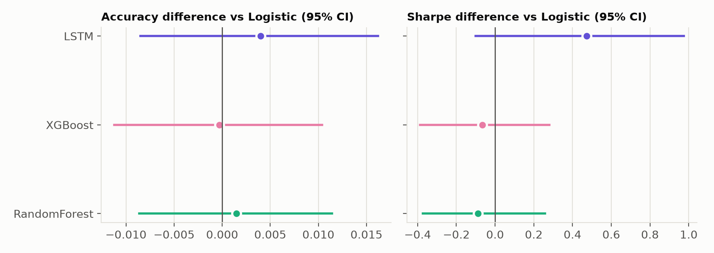
*Figure 9. Accuracy and Sharpe differences versus logistic regression with 95% block-bootstrap intervals. All accuracy
intervals contain zero.*

- **Accuracy:** none of the 6 comparisons is significant under any of the three tests after Holm correction
  (smallest Holm-adjusted DM p-value: 0.40; smallest raw: 0.067, LSTM vs ARIMA).
- **Sharpe:** only one of the 6 comparisons is significant: LSTM over ARIMA (Holm-adjusted p = 0.016).
  Against logistic regression, the LSTM's raw bootstrap p-value is 0.044 but the Holm-adjusted value is
  0.219. Against buy-and-hold its Sharpe advantage is +0.41
  (95% CI [-0.11, 0.90], unadjusted p = 0.064), also
  not significant.

### 6.4 Robustness

Regimes are defined using only information known at each close: bull/bear by SPY above or below its 200-day average
(977 bull and 279 bear test days), and low/high volatility by VIX below or above 20 (652 and 604 days).

| Model | Bull | Bear | Low volatility | High volatility |
|---|---:|---:|---:|---:|
| Buy & hold | 52.8% | 51.7% | 52.4% | 52.6% |
| Logistic | 51.2% | 51.2% | 51.2% | 51.3% |
| ARIMA | 50.4% | 51.7% | 49.6% | 51.8% |
| Random forest | 51.4% | 51.3% | 51.3% | 51.5% |
| XGBoost | 51.1% | 51.7% | 51.0% | 51.4% |
| LSTM | 51.9% | 50.7% | 51.7% | 51.6% |

*Table 4. Accuracy by market regime.*

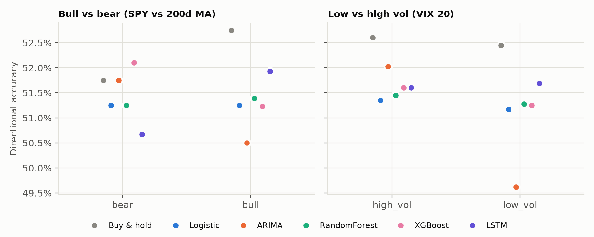
*Figure 10. Accuracy by regime. Differences between models are small and inconsistent in sign.*

Within every regime, no challenger's accuracy advantage over logistic regression is significant (smallest Holm-adjusted
p-value 0.99).

| Test year | Buy & hold | Logistic | ARIMA | Random forest | XGBoost | LSTM |
|---|---:|---:|---:|---:|---:|---:|
| 2020 | 51.8% | 52.1% | 50.6% | 52.0% | 52.2% | 50.8% |
| 2021 | 52.8% | 51.8% | 52.5% | 51.4% | 51.0% | 51.8% |
| 2022 | 49.6% | 47.9% | 50.2% | 49.0% | 50.0% | 48.9% |
| 2023 | 54.2% | 51.6% | 50.6% | 53.0% | 51.6% | 53.9% |
| 2024 | 54.2% | 52.8% | 49.5% | 51.6% | 51.3% | 52.8% |

*Table 5. Accuracy by test year.*

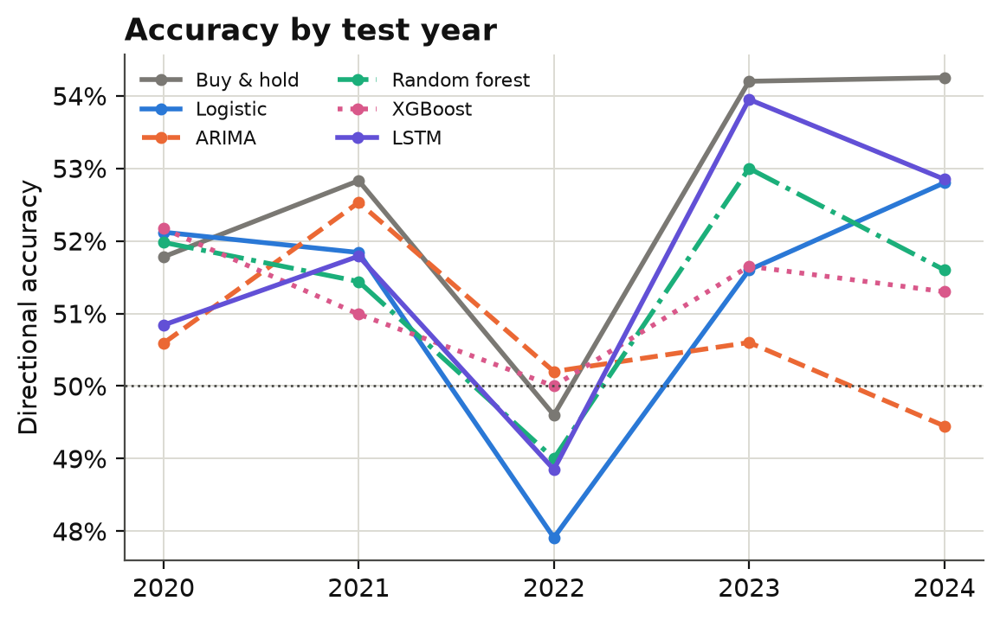
*Figure 11. Accuracy by test year.*

All models, and the benchmark, fall in 2022 (when 49.6% of days were up) and recover in 2023, so year-to-year
swings are driven by how many days were up, not by model quality. By stock (Figure 12), the best non-benchmark model differs
across tickers (5 different winners among the eight stocks) and accuracy ranges from
46.6% (XOM, Logistic) to 55.2% (TSLA, XGBoost), the pattern expected when differences are mostly noise.

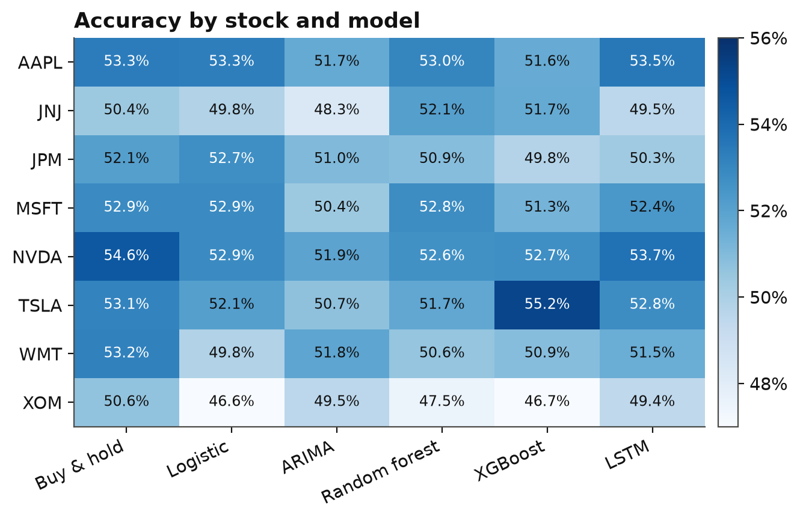
*Figure 12. Accuracy by stock and model.*

---

## 7. Analysis

### 7.1 Why the indicators carry so little information

Figure 13 shows the correlation of each of the 26 indicators with the next-day direction label, pooled over all
20,112 stock-days. The strongest correlation has magnitude 0.028, which explains well under 0.1% of the variance. Under an
independence assumption the standard error of a correlation here is about 0.0071, so only 3 indicators
(ret_lag1, mkt_ret, ma5_ratio) exceed two standard errors, and the independence assumption is generous because stocks move together.
The significant ones are negative, which is a faint short-term reversal effect: a stock that rose today or this week is
slightly less likely to rise tomorrow. Many indicators are also strongly related to each other (the moving-average
ratios, momentum and RSI all describe recent trend), so adding more of them adds little new information.

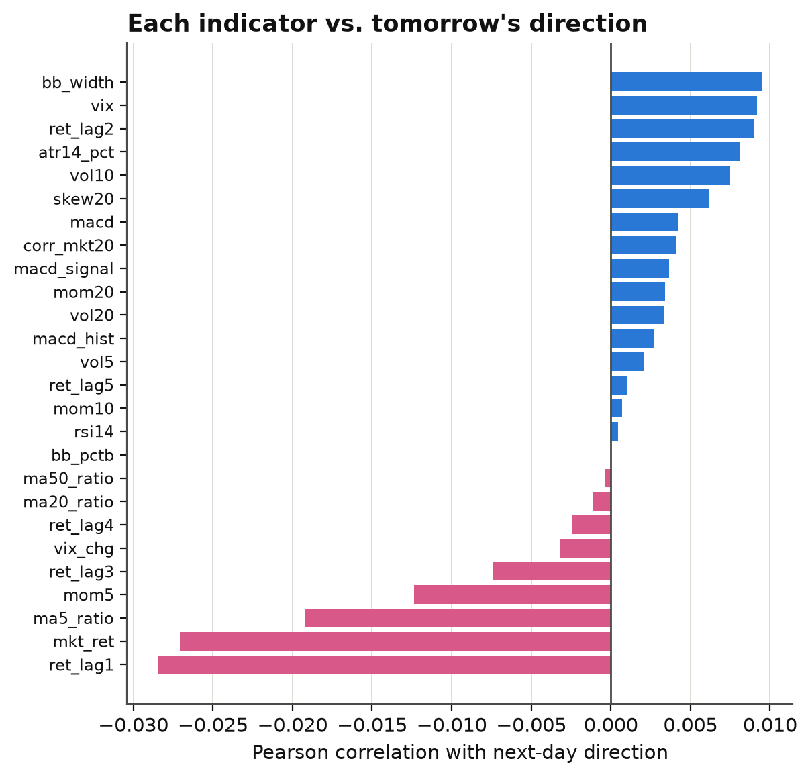
*Figure 13. Correlation of each indicator with next-day direction.*

| Indicator | Correlation with next-day direction |
|---|---:|
| ret_lag1 | -0.0285 |
| mkt_ret | -0.0271 |
| ma5_ratio | -0.0192 |
| mom5 | -0.0123 |
| bb_width | +0.0095 |
| vix | +0.0092 |
| ret_lag2 | +0.0090 |
| atr14_pct | +0.0081 |

*Table 6. The four most negative and four most positive correlations.*

### 7.2 Market exposure and turnover

Accuracy and AUC say nothing about how a strategy earns money. Table 7 shows two properties that determine its backtest.

| Strategy | Share of days long | Position changes per stock per year | Same exposure without timing (annualised) | Actual annualised return |
|---|---:|---:|---:|---:|
| Buy & hold | 100% | 0 | 36.1% | 36.1% |
| Logistic | 66% | 68 | 23.3% | 26.6% |
| ARIMA | 69% | 112 | 24.4% | 19.9% |
| Random forest | 71% | 57 | 25.4% | 26.2% |
| XGBoost | 62% | 82 | 22.1% | 24.4% |
| LSTM | 79% | 21 | 28.1% | 32.4% |

*Table 7. Exposure and turnover. "Same exposure without timing" holds buy-and-hold on a fixed fraction of capital equal to
the model's average exposure, with the rest in cash.*

The LSTM is invested on 79% of days, more than any other predictive model, in a rising market,
so some of its return is simply market exposure: a naive mix with the same exposure and no timing earns 28.1%
a year, versus the LSTM's actual 32.4%. The more striking difference is turnover. The LSTM changes
position about 21 times per stock per year; the other predictive models change position
57 to 112 times.

### 7.3 Sensitivity to transaction costs

| Strategy | 0 bp | 5 bp | 10 bp | 25 bp | 50 bp |
|---|---:|---:|---:|---:|---:|
| Buy & hold | 1.38 | 1.38 | 1.38 | 1.38 | 1.37 |
| Logistic | 1.48 | 1.31 | 1.14 | 0.61 | -0.25 |
| ARIMA | 1.37 | 1.07 | 0.77 | -0.14 | -1.64 |
| Random forest | 1.36 | 1.22 | 1.09 | 0.67 | -0.01 |
| XGBoost | 1.46 | 1.24 | 1.03 | 0.38 | -0.70 |
| LSTM | 1.85 | 1.78 | 1.72 | 1.54 | 1.22 |

*Table 8. Sharpe ratio at different transaction costs (basis points per unit of turnover).*

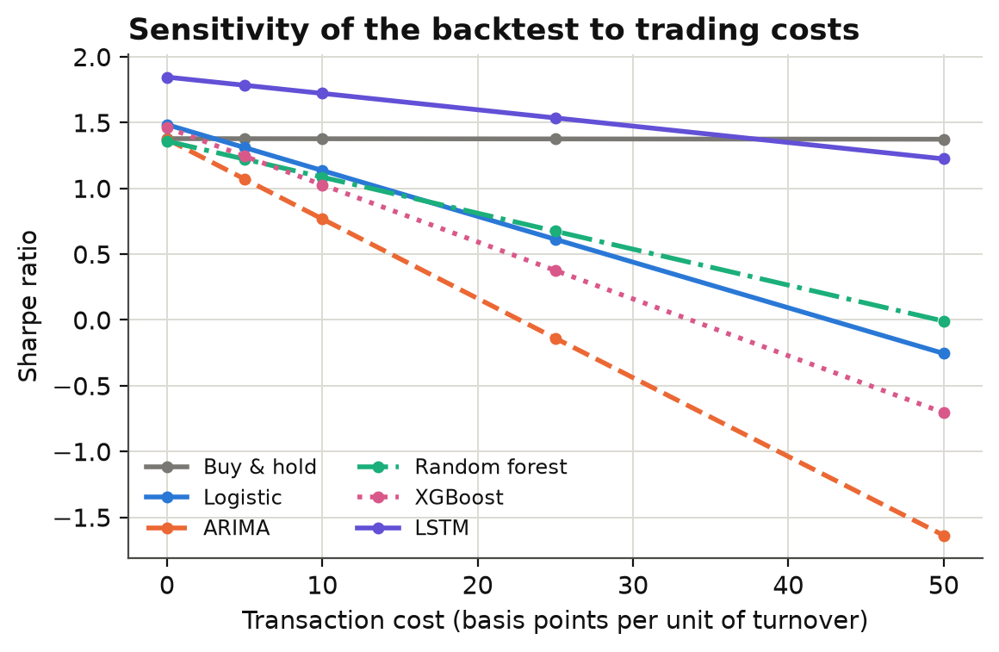
*Figure 14. Sharpe ratio as trading costs rise.*

Without costs, logistic regression (1.48) and XGBoost (1.46) are comparable to
buy-and-hold (1.38), so their weak backtests at 5 bp are largely the price of frequent trading,
not of bad calls. At 25 bp the classical and tree strategies fall to between -0.14 and
0.67, and at 50 bp their Sharpe ratios range from -1.64 to
-0.01. The LSTM's Sharpe falls only from 1.85 to 1.22 because it trades
rarely. Buy-and-hold is nearly unaffected.

### 7.4 What explains the LSTM's backtest advantage?

The evidence points to **persistence of positions, not superior forecasting**. Its AUC (0.502) is no better than the simpler models', its accuracy
(51.6%) is only slightly higher and not significantly so, and it remains below buy-and-hold on accuracy, but
its positions change rarely and it is mostly invested, which keeps costs low and captures much of the market's upward drift
while avoiding some drawdowns (maximum drawdown -19.6% versus -33.3%
for buy-and-hold). A plausible but untested explanation is that its 20-day input windows overlap almost entirely from one day to the next,
so its output probability changes slowly and crosses the 0.5 threshold rarely. Testing this (for example by smoothing the other
models' scores, or by comparing against a model with a longer holding rule) is future work.
Even so, the advantage is statistically fragile: it is significant against ARIMA only, and its confidence interval against
buy-and-hold includes zero.

### 7.5 Run-to-run sensitivity

The models are deterministic given the data, yet results moved between successive complete runs of the pipeline during
development, because Yahoo Finance retroactively revises adjusted prices. Across those runs ARIMA's cumulative backtest return
ranged from about 135% to 154% and XGBoost's from about 197% to 219%, while the always-up and logistic results barely moved and
the conclusions never changed. That small input changes shift some strategies by tens of percentage points is itself evidence of how
little signal there is to anchor the models.

---

## 8. Summary of findings

1. **Complexity did not buy predictive accuracy.** All models score 50.7%-51.6%, and none beats
   always-up (52.5%). None of the 6 challenger-vs-baseline accuracy comparisons is significant
   after Holm correction.
2. **There is almost no ranking signal.** ROC-AUC lies between 0.494 and 0.505 for every model, and no single indicator
   correlates with next-day direction above 0.028.
3. **The LSTM has the best backtest, but for reasons other than forecasting skill.** Sharpe 1.78, driven by high
   market exposure (79% of days) and low turnover (21 position changes per stock per year).
   Its advantage is significant against ARIMA only.
4. **Costs decide the ranking.** The classical and tree-based strategies roughly match buy-and-hold before costs but lose to it
   as costs rise; at 50 bp their Sharpe ratios are between -1.64 and -0.01.
5. **Results are consistent across regimes, years and stocks.** No challenger advantage is significant in any regime, and year-to-year
   changes track the share of up-days rather than model quality.
6. **We fail to reject H0.** "No significant difference" is not proof of equality: with about 1,256 test days, differences smaller
   than roughly 1.5 percentage points of accuracy cannot be detected.

---

## 9. Limitations

- **Statistical power.** With about 1,256 test days, the standard error of an accuracy difference is around 0.6 percentage points.
- **Survivorship and selection bias.** The stocks are well-known long-run winners, which flatters long-biased strategies.
- **Single seed and fixed hyperparameters** for stochastic models; no tuning, so stronger configurations may exist.
- **Data revisions.** Section 7.5 shows results move with the vendor's revisions.
- **ARIMA** forecasts a return, not a probability, so its AUC uses the forecast as the score.
- **Loss function.** Diebold-Mariano tests use 0/1 loss, the only loss common to all models, which ignores confidence and
  the size of moves.
- **Simplified trading.** Close-to-close execution, one cost level, zero risk-free rate, no slippage, taxes or capacity limits.
- **One horizon, one window length.** Only next-day direction and a 5-year window were studied; the per-year tables stand in for a
  window-length sensitivity analysis.
- **Untested explanation.** The persistence account of the LSTM result (Section 7.4) is consistent with the data but not
  directly tested.

## 10. Future work

1. **Wider, survivorship-free universe:** hundreds of stocks including delisted names, with cross-sectional (ranking) targets and a
   long/short portfolio, which also raises statistical power.
2. **More horizons and targets:** multi-day and weekly direction, return magnitude, and volatility forecasting, where predictability
   is generally stronger than for direction.
3. **Test the persistence hypothesis:** smooth or threshold-band the other models' signals, or add holding-period rules, to see whether
   they close the gap with the LSTM.
4. **Richer information:** volume and order-flow features, fundamentals, news and sentiment text, and cross-asset signals.
5. **More careful tuning and ensembling:** nested time-series cross-validation, many random seeds, and ensembles of networks, with a
   correction for the number of configurations tried.
6. **Other architectures:** GRU, temporal convolution and Transformer models, plus the originally planned SVM and GARCH baselines.
7. **Probability-aware trading:** calibrated probabilities, confidence-based position sizing, and a no-trade band to reduce turnover.
8. **More realistic execution:** bid-ask spreads, market impact, a risk-free rate, and eventually paper trading on live data.
9. **Stronger inference:** deflated Sharpe ratios and other multiple-testing corrections across strategies, and longer test periods that
   include several market cycles.

---

## 11. Conclusion

We compared classical, machine-learning and deep-learning models for next-day stock direction under leakage-controlled walk-forward
validation. None of the more complex models improved accuracy significantly over a logistic-regression baseline, and all fell short of
always predicting "up". The LSTM's attractive risk-adjusted backtest is real in this sample, but it comes from staying invested and
trading rarely rather than from better predictions, and it is statistically significant only against the weakest baseline. For
short-horizon direction from daily price-based indicators, the evidence supports market efficiency over model sophistication, and shows why
costs, exposure and formal testing matter as much as headline accuracy.

## 12. Reproducibility

All code, configuration and data-handling steps are in the project repository. `python scripts/run_all.py` regenerates the data,
predictions, tables and website data (seed 42; settings in `config.yaml`); `python scripts/11_report_figures.py` and
`python scripts/12_build_paper.py` rebuild the figures and this paper from the saved results, so every number here is read from the
result files at build time. An interactive version of the results is provided by the accompanying website. Because Yahoo Finance revises
history, a fresh download can change some numbers slightly (Section 7.5).

---

## References

Bailey, D. H., Borwein, J. M., López de Prado, M., & Zhu, Q. J. (2014). Pseudo-mathematical financial charlatanism: The effects of
backtest overfitting on out-of-sample performance. *Notices of the American Mathematical Society, 61*(5), 458-471.

Box, G. E. P., & Jenkins, G. M. (1970). *Time Series Analysis: Forecasting and Control.* Holden-Day.

Breiman, L. (2001). Random forests. *Machine Learning, 45*(1), 5-32.

Chen, T., & Guestrin, C. (2016). XGBoost: A scalable tree boosting system. In *Proceedings of the 22nd ACM SIGKDD International
Conference on Knowledge Discovery and Data Mining* (pp. 785-794).

Diebold, F. X., & Mariano, R. S. (1995). Comparing predictive accuracy. *Journal of Business & Economic Statistics, 13*(3), 253-263.

Fama, E. F. (1970). Efficient capital markets: A review of theory and empirical work. *The Journal of Finance, 25*(2), 383-417.

Fischer, T., & Krauss, C. (2018). Deep learning with long short-term memory networks for financial market predictions.
*European Journal of Operational Research, 270*(2), 654-669.

Gu, S., Kelly, B., & Xiu, D. (2020). Empirical asset pricing via machine learning. *The Review of Financial Studies, 33*(5), 2223-2273.

Harvey, D., Leybourne, S., & Newbold, P. (1997). Testing the equality of prediction mean squared errors. *International Journal of
Forecasting, 13*(2), 281-291.

Hochreiter, S., & Schmidhuber, J. (1997). Long short-term memory. *Neural Computation, 9*(8), 1735-1780.

Holm, S. (1979). A simple sequentially rejective multiple test procedure. *Scandinavian Journal of Statistics, 6*(2), 65-70.

Kingma, D. P., & Ba, J. (2015). Adam: A method for stochastic optimization. In *International Conference on Learning Representations (ICLR).*

López de Prado, M. (2018). *Advances in Financial Machine Learning.* Wiley.

Newey, W. K., & West, K. D. (1987). A simple, positive semi-definite, heteroskedasticity and autocorrelation consistent covariance
matrix. *Econometrica, 55*(3), 703-708.

Politis, D. N., & Romano, J. P. (1994). The stationary bootstrap. *Journal of the American Statistical Association, 89*(428), 1303-1313.

Sharpe, W. F. (1966). Mutual fund performance. *The Journal of Business, 39*(1), 119-138.

Srivastava, N., Hinton, G., Krizhevsky, A., Sutskever, I., & Salakhutdinov, R. (2014). Dropout: A simple way to prevent neural
networks from overfitting. *Journal of Machine Learning Research, 15*, 1929-1958.

Welch, I., & Goyal, A. (2008). A comprehensive look at the empirical performance of equity premium prediction. *The Review of
Financial Studies, 21*(4), 1455-1508.
