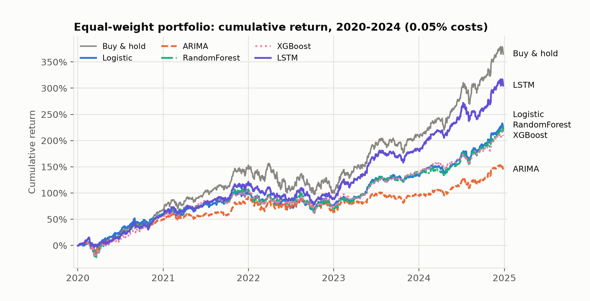
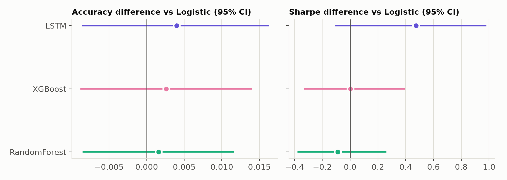
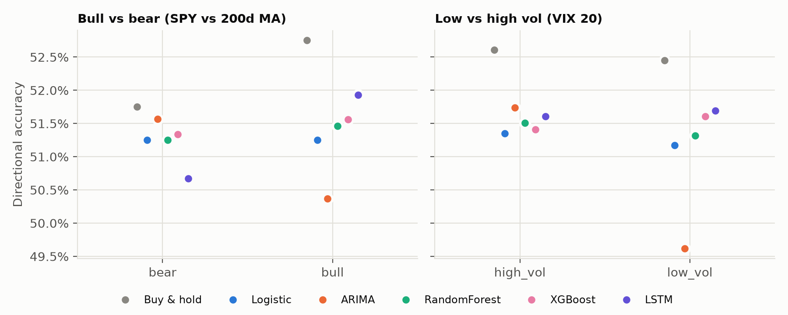

# Do Machine Learning Models Beat Classical Models at Predicting Next-Day Stock Direction? A Walk-Forward Comparison

## Abstract

We compare two classical models (logistic regression, ARIMA) with two machine-learning models
(Random Forest, XGBoost) and one deep-learning model (LSTM) for predicting the next-day return
direction of eight liquid U.S. equities, using strict rolling walk-forward validation
(5-year training window, out-of-sample years 2020-2024) and a long/cash backtest with 0.05%
transaction costs. All models reach 50.6-51.7% directional accuracy with ROC-AUC between 0.495
and 0.506, versus 52.5% for an always-"up" benchmark. Diebold-Mariano tests, stationary-block
bootstrap confidence intervals and paired t-tests find **no statistically significant accuracy
improvement from added model complexity** after Holm correction. The LSTM has the best
risk-adjusted backtest of the predictive models (Sharpe 1.78 vs 1.31 for logistic regression),
but the difference is not significant against logistic regression or buy-and-hold; it is
significant only against ARIMA, the weakest baseline. Results are similar in bull/bear and
high/low-volatility regimes. We fail to reject the null hypothesis.

## 1. Research question and hypotheses

Do ML/DL models significantly outperform classical econometric models in predicting next-day
return direction under realistic trading constraints?

- H0: no significant difference in predictive performance between classical and ML models.
- H1: ML and/or DL models significantly outperform the classical baseline.

## 2. Data

Daily split/dividend-adjusted OHLCV from Yahoo Finance (`yfinance`), 2014-2024, for AAPL, MSFT,
NVDA, JPM, TSLA, XOM, JNJ and WMT, plus SPY (market) and ^VIX (volatility). 2014 is used only
as indicator warm-up; modelled data start in 2015 (20,112 stock-day observations). Data are stored
in SQLite. The target is `y_t = 1[r_{t+1} > 0]`, where `r_{t+1}` is the close-to-close return from
day t to t+1; up-days are 50.4-54.6% of observations depending on the ticker.

## 3. Features (26)

All features at day t use information up to the close of day t (verified by a unit test that
perturbs future prices). *Technical:* RSI(14), MACD line/signal/histogram, Bollinger %B and
width, price/MA ratios (5, 20, 50), ATR(14)/price. *Statistical:* rolling volatility (5, 10, 20),
lagged returns (1-5), 20-day skewness, momentum (5, 10, 20). *Market context:* SPY return, 20-day
rolling correlation with SPY, VIX level and change. Z-score normalisation is fitted on the training
window only, inside each model.

## 4. Models

| Class | Model | Notes |
|---|---|---|
| Benchmark | Always-up | Equivalent to buy-and-hold |
| Classical | Logistic regression | L2 (C = 0.1), standardised inputs |
| Classical | ARIMA(p,0,q) | order by AIC on the training window (p, q <= 2); one-step forecasts, sign decides the position |
| ML | Random Forest | 300 trees, depth 5, min leaf 20 |
| ML | XGBoost | 200 trees, depth 3, lr 0.03, subsampling, L2 = 5 |
| DL | LSTM | 20-day window, 32 hidden units, dropout 0.3, early stopping on a chronological 15% tail |

Hyperparameters were fixed in advance, deliberately conservative for noisy financial data, and were
**not** tuned on test years. A separate model is fitted for every ticker and fold. The plan's SVM,
GRU and GARCH extensions were left out to keep the study to one or two models per class; the
plan's abstract also commits to this narrower comparison.

## 5. Experimental design

Rolling walk-forward: train on the previous five calendar years, test on the next year
(2015-19 -> 2020, 2016-20 -> 2021, ..., 2019-23 -> 2024). Data are never shuffled across time (the
LSTM shuffles windows only inside its training set). The final training row of each fold is purged,
since its label depends on the first test-year close.

**Backtest.** Predict up -> hold the stock for the next day, otherwise cash (0% return, no
leverage), with 0.05% cost per unit of turnover. Equal-weight, daily-rebalanced portfolio across the
eight tickers; Sharpe uses a zero risk-free rate and 252 days.

**Significance tests** (challengers vs each classical baseline, one-sided per H1, Holm-corrected
across the six comparisons): Diebold-Mariano on 0/1 loss averaged across tickers per date
(Newey-West variance, Harvey-Leybourne-Newbold correction); stationary block bootstrap
(5,000 draws, mean block 10 days) for accuracy and Sharpe differences; paired t-test on
per-ticker-per-year accuracies.

## 6. Results

### 6.1 Predictive performance (pooled, 10,048 out-of-sample predictions)

| Model | Accuracy | Precision | Recall | F1 | ROC-AUC |
|---|---|---|---|---|---|
| Always-up | 0.5253 | 0.5253 | 1.0000 | 0.6888 | 0.5000 |
| Logistic | 0.5125 | 0.5288 | 0.6612 | 0.5876 | 0.5046 |
| ARIMA | 0.5062 | 0.5229 | 0.6823 | 0.5921 | 0.4947 |
| Random Forest | 0.5132 | 0.5270 | 0.7147 | 0.6067 | 0.5039 |
| XGBoost | 0.5143 | 0.5320 | 0.6266 | 0.5754 | 0.5055 |
| LSTM | 0.5165 | 0.5265 | 0.7893 | 0.6317 | 0.5020 |

No model beats the always-up benchmark on accuracy, and all ROC-AUCs are within 0.006 of 0.5:
there is essentially no usable ranking signal. Accuracy and F1 are dominated by how often a model
says "up".

### 6.2 Backtest (equal-weight portfolio, 0.05% costs)

| Strategy | Cum. return | Ann. return | Sharpe | Max drawdown | Calmar |
|---|---|---|---|---|---|
| Buy & hold | 365% | 36.1% | 1.38 | -33.3% | 1.09 |
| Logistic | 223% | 26.6% | 1.31 | -20.7% | 1.28 |
| ARIMA | 145% | 19.7% | 1.06 | -21.4% | 0.92 |
| Random Forest | 217% | 26.0% | 1.21 | -29.4% | 0.88 |
| XGBoost | 209% | 25.4% | 1.28 | -25.9% | 0.98 |
| LSTM | 305% | 32.4% | 1.78 | -19.6% | 1.65 |

The LSTM has the highest Sharpe and Calmar ratios. However, it is long about 79% of the time (its
recall), in a strongly rising sample, so part of its performance is market exposure rather than
timing skill, and its AUC is only 0.502.

### 6.3 Statistical significance

Selected results (full table: `results/tables/significance_vs_baselines.csv`). Accuracy
differences are challenger minus baseline; all p-values are one-sided and Holm-adjusted.

| Challenger vs baseline | Acc. diff | DM p | Sharpe diff [95% CI] | Bootstrap Sharpe p |
|---|---|---|---|---|
| RF vs Logistic | +0.07 pp | 0.80 | -0.10 [-0.38, 0.25] | 1.00 |
| XGBoost vs Logistic | +0.18 pp | 0.80 | -0.03 [-0.36, 0.36] | 1.00 |
| LSTM vs Logistic | +0.40 pp | 0.80 | 0.47 [-0.10, 0.97] | 0.22 |
| RF vs ARIMA | +0.71 pp | 0.52 | 0.15 [-0.21, 0.60] | 0.68 |
| XGBoost vs ARIMA | +0.82 pp | 0.52 | 0.22 [-0.18, 0.72] | 0.68 |
| LSTM vs ARIMA | +1.04 pp | 0.34 | 0.72 [0.19, 1.21] | **0.019** |

- No accuracy comparison is significant (DM, bootstrap or paired t-test) after Holm correction;
  the smallest raw one-sided DM p-value is 0.058 (LSTM vs ARIMA).
- The only significant result is the LSTM's Sharpe advantage over ARIMA. Against logistic regression
  and against buy-and-hold (Sharpe difference +0.41, 95% CI [-0.11, 0.90], unadjusted p = 0.064) it
  is not significant.

### 6.4 Robustness

Regimes are defined ex-ante: bull/bear by SPY above/below its 200-day average (78%/22% of test
days), low/high volatility by VIX below/above 20 (52%/48%). No model's accuracy advantage over
logistic regression is significant in any regime (all Holm-adjusted p > 0.98). Results by year and
by ticker are in `results/tables/classification_by_year.csv`, `classification_by_ticker.csv` and
`backtest_by_ticker.csv`. The best model by accuracy differs across tickers (five different
winners across eight tickers), which is what one expects when differences are noise.

## 7. Discussion

Next-day direction is close to unpredictable from daily price-based features, in line with weak-form
market efficiency: every model sits within about one percentage point of 51%, and nothing beats
simply being long. Increased model complexity did not translate into significantly better
prediction. The LSTM's better backtest is interesting but statistically fragile; it is partly
explained by higher market exposure and a smoother drawdown profile, and with a single seed and
1,256 test days it cannot be distinguished from luck against the stronger baselines.

## 8. Limitations

- **Power.** With about 1,256 test days, the standard error of an accuracy difference is around
  0.6 pp, so effects smaller than roughly 1.5 pp cannot be detected. "No significant difference" is
  not proof of equality.
- **Survivorship / selection bias.** The tickers (NVDA, TSLA, AAPL, ...) are known long-run winners,
  which flatters any long-biased strategy and makes buy-and-hold hard to beat.
- **Single seed, fixed hyperparameters** for stochastic models; no hyperparameter search.
- **Sensitivity to data revisions.** Yahoo Finance adjusts historical prices retroactively. Re-downloading the
  data and re-running the identical pipeline moved ARIMA's backtest cumulative return from 135% to 145% and
  XGBoost's from 219% to 209%, while the logistic and LSTM results were essentially unchanged and no
  conclusion changed. The models themselves are deterministic given the data (verified by refitting), so
  this sensitivity comes from tiny input changes, which is itself a sign of how little signal there is.
- **ARIMA** forecasts returns, not probabilities, so its ROC-AUC uses the forecast as the score.
- DM tests use 0/1 loss (the only loss common to all models). Regime Sharpe ratios are computed on
  non-contiguous days. Zero risk-free rate, one cost level (0.05%), close-to-close execution and no
  slippage or taxes.
- A 5-year window only; the plan's "different time windows" check is covered by the per-year
  tables, not by varying the window length.

## 9. Conclusion

We fail to reject H0: complex ML and deep-learning models do not deliver statistically significant
improvements in next-day directional accuracy over a logistic-regression baseline. Their economic
value is limited too: apart from the LSTM-vs-ARIMA Sharpe comparison, no risk-adjusted difference
is significant, and the always-up benchmark beats every model on accuracy.

## Reproducibility

`python scripts/run_all.py` regenerates every table and figure (seed 42, configuration in
`config.yaml`). Yahoo Finance data can be revised over time, so re-downloaded numbers may
differ from those reported here (see Limitations); the tables in this paper correspond to the data
downloaded on 2026-10-10.
